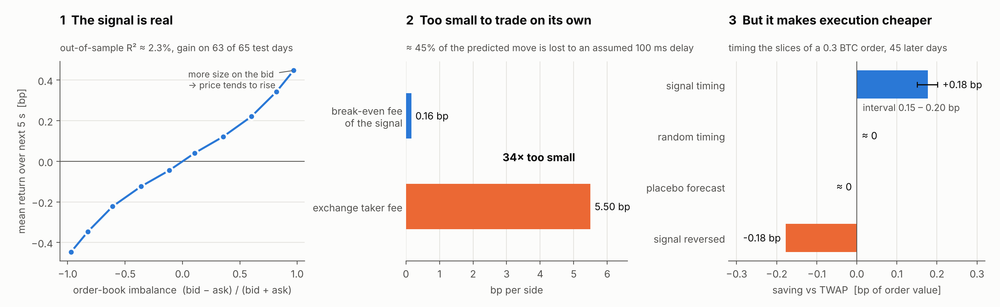
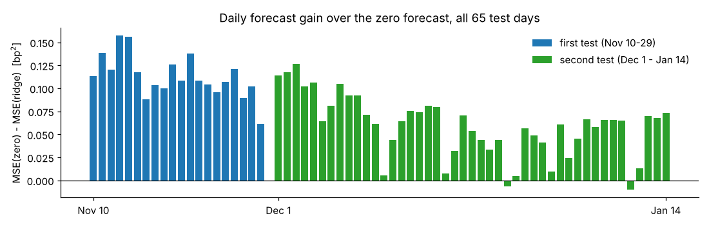
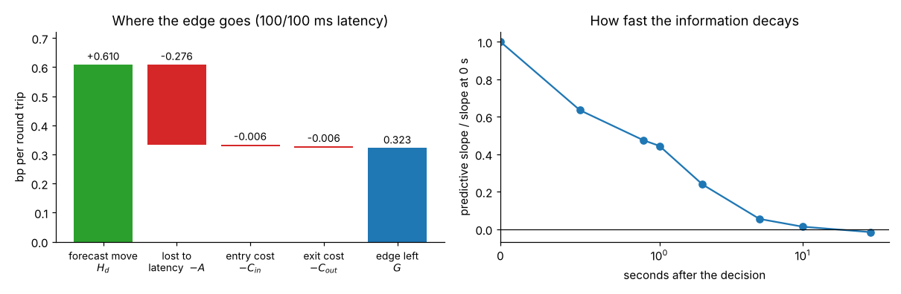
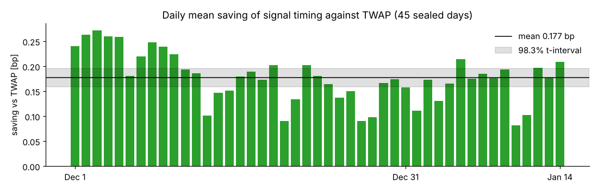
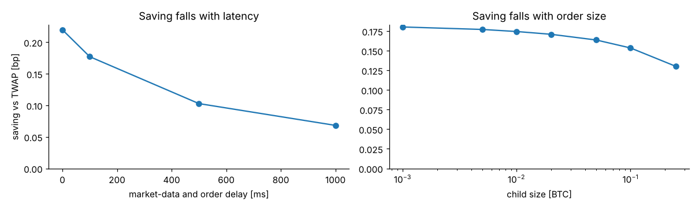

# Order-book imbalance in BTCUSDT: forecasting, standalone trading and execution

An empirical study of the Bybit BTCUSDT perpetual. The limit order book is reconstructed from raw exchange data, a 5-second return forecast is built from its state, and the forecast is evaluated in two applications: as a standalone taker strategy and as a timing signal for order execution.

## Key results

| | result | estimate | interval ¹ |
|---|---|:---:|:---:|
| **Forecast** | Out-of-sample R² (first / second test period) | **2.3% / 2.2%** | gain on 63 of 65 days |
| **Standalone trading** | Break-even fee per side, against a 5.5 bp taker fee | **0.16 bp** | 0.13 – 0.19 |
| **Latency** | Share of the realised move lost to the assumed latency (100 ms data + 100 ms order) | **45%** | – |
| **Execution** | Saving of signal-timed slicing against TWAP | **0.18 bp** | 0.15 – 0.20 |
| **Controls** | Saving of random timing and of a time-shifted placebo | **0.00 bp** | – |

¹ Widest of the day-level block-bootstrap and t-intervals, Bonferroni-adjusted. The break-even fee is a ratio of sums over days and has bootstrap intervals only.



## Data and method

**Data.** 105 days of Bybit order-book updates (top 200 levels, about every 100 ms) and trades, October 2025 to January 2026.

**Order book.** Snapshots and incremental updates are replayed in integer price and size units, with checks for sequence gaps and crossed books. Every second, the state of the book is recorded as it was visible strictly before the decision time, after an explicit market-data delay.

**Model.** Eight features: order-flow imbalance, best-level and five-level book imbalance, trade imbalance, spread, last-second return, trade count and 30-second volatility. A ridge regression is fitted on 40 training days. Validation error is flat in λ, so the model is effectively OLS, and best-level and five-level book imbalance carry almost all of the weight.

**Evaluation.** The model and all decision rules were fixed on the training days and evaluated on 20 days (Nov 10–29). The execution study was then specified, frozen and evaluated on 45 later days (Dec 1 – Jan 14), together with a re-test of the unchanged forecast. Inference uses the day as the unit: a moving-block bootstrap over days (blocks of 1, 2 and 5) and a t-interval, each at level 1 − 0.05/3 (Bonferroni over the three primary quantities of each test). A result is classified only if all intervals agree: four for the daily means, three for the break-even fee, which is a ratio and has no t-interval. The re-test of the forecast in the second period is reported at the same level, outside its three primary quantities.

## Results

**Forecast.** The forecast beats the zero forecast in both test periods and on 63 of 65 days. Its gain is smaller in the second period, but remains positive without refitting.



**Standalone trading.** A taker policy that trades the strongest 10% of forecasts with market orders breaks even at a fee of 0.16 bp per side. Decomposing each round trip shows that 45% of the realised mid move has already happened when the order arrives, under the assumed 100 ms market-data delay and 100 ms order delay, while spread and book-walking costs are negligible. Refitting at horizons of 1 to 300 seconds does not help: even the 99th percentile of the forecast stays at least 13 times below the round-trip cost.



**Execution.** A 0.3 BTC parent order is split into 60 market-order children over 10 minutes, and each child may be delayed by up to 9 seconds when the forecast is favourable. Over 4,320 parent orders, this saves 0.18 bp against TWAP. Random delays, drawn from the signal's delay distribution on the earlier days and fixed in advance, and a time-shifted forecast save nothing, and the reversed signal costs 0.18 bp. The saving declines with latency and with child-order size.





## Limitations

Simulated orders do not affect the book, so results hold only for the small order sizes tested. Latencies are assumed rather than measured. Only market orders are modelled. The sample covers a single venue and instrument over three and a half months.

## Next steps

- **Non-linear order-flow features**, such as clipped or transformed OFI, fixed on the training days and tested on data after January 2026.
- **Passive execution and market impact:** limit orders with a queue-position model, and an impact model to extend the execution study to larger orders.

## Repository

```
orderflow/    order-book replay, features, model, taker and execution simulation, statistics
notebooks/    01_signal, 02_trading_alone, 03_execution
scripts/      data download, single-day pipeline, model refit, summary figure
results/      frozen model and per-day results of all test days (see results/README.md)
tests/        unit tests, including a recomputation of every reported interval
```

## Reproduction

```bash
pip install -r requirements.txt
python -m unittest                                   # unit tests
python scripts/download_sample.py 2025-12-01         # one day of raw data (~400 MB)
python scripts/run_day.py 2025-12-01                 # rebuild and compare with the original run
```

The notebooks run from `results/` without raw data. `scripts/run_day.py` rebuilds a test day from raw data and compares it with the original run (`results/reference_days.json`). All 45 days of the second test period and one day of the first (Nov 10) were rerun this way and matched exactly, in the pinned environment of `requirements.txt`; on other platforms the floating-point results may differ in the last digits. `scripts/fit_model.py` refits the model from the 40 training days.

---

