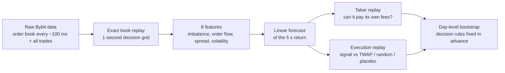
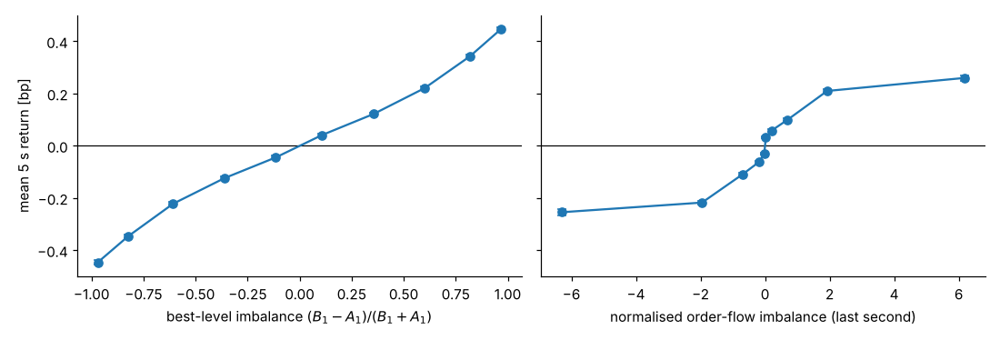

# Order-book imbalance in Bitcoin: no standalone alpha, but cheaper execution


Does the public order book of the Bybit BTCUSDT perpetual predict the next 5 seconds of price movement, and is that prediction worth anything after trading costs? This study answers both questions on 105 days of tick-level data, with two out-of-sample test periods and every decision rule fixed in advance.

## Key results

| | result | estimate | interval ¹ |
|---|---|:---:|:---:|
| **Signal** | Out-of-sample R² of the 5 s forecast (first / second test) | **2.3% / 2.2%** | gain on 63 of 65 test days |
| **Standalone trading** | Break-even fee per side, against a 5.5 bp taker fee | **0.16 bp** | 0.13 – 0.19 |
| **Cause** | Share of the predicted move lost to an assumed 100 ms delay | **45%** | – |
| **Execution value** | Saving of signal-timed slicing against TWAP (0.3 BTC parent orders) | **0.18 bp** | 0.15 – 0.20 |
| **Controls** | Saving of random timing and of a time-shifted placebo against TWAP | **0.00 bp** | – |

¹ Widest of the day-level block-bootstrap intervals (blocks of 1, 2 and 5 days) and the t-interval, Bonferroni-adjusted.

> **Conclusion.** The order book carries a real and stable 5-second signal, but it is about 34× too small to pay taker fees, mainly because most of it is gone before an order can arrive. Its value lies in execution: timing the slices of an order that must be traded anyway saves 0.18 bp against TWAP at the tested size, while the same timing pattern without the signal saves nothing.

**Skills shown:** market microstructure · limit-order-book reconstruction from raw exchange data · time-series validation without look-ahead · bootstrap inference with dependent data · execution cost analysis (TWAP, implementation shortfall) · reproducible research in Python/NumPy with unit tests.


---

## Research process

The study ran in five stages. Each test period was opened once, after the model and the rules for that stage had been frozen.

| stage | data | work | outcome |
|---|---|---|---|
| **1. Build and fit** | Oct 1 – Nov 9, 2025 (40 days) | Exact order-book replay, eight features, ridge forecast; λ selected on two forward folds. Model, thresholds and test rules frozen. | Frozen model |
| **2. First test** | Nov 10–29, 2025 (20 days) | Forecast accuracy against the zero and OFI forecasts; taker policy under fees and latency. | Signal confirmed; not tradable on its own |
| **3. Diagnosis** | First-test round trips | Each round trip decomposed into forecast move, latency loss, entry and exit cost; refits at horizons of 1–300 s. | Edge lost to latency, not to the spread; longer horizons do not help |
| **4. Reformulation** | – | New question: if the signal cannot pay for its own trades, can it lower the cost of trades that must happen anyway? Execution study designed and frozen: schedules, benchmarks, placebos, decision rules. | Frozen execution design |
| **5. Second test** | Dec 1, 2025 – Jan 14, 2026 (45 days, downloaded after stage 4) | Execution replay against TWAP, random timing and placebo; frozen forecast re-tested. | Execution value confirmed; signal stable |

## How it works



**The model.** Each second, eight features are computed from the order book the trader could actually see. The model is a ridge regression, but with 3.4 million rows and eight features the penalty does almost nothing (validation error is flat in λ), so it is effectively ordinary least squares. Two features carry nearly all the weight: best-level and five-level **order-book imbalance**. When more size waits on the bid than on the ask, the price tends to tick up.



## Design choices

| choice | rationale |
|---|---|
| **Bybit BTCUSDT perpetual** | Free public archives with the full top-200 book and every trade; one of the most liquid crypto markets. |
| **1-second grid, 5-second horizon** | Long relative to the assumed 100 ms latency, short enough for the book state to remain informative. Longer horizons are tested in notebook 2. |
| **Integer replay, strict-past timing** | Prices and sizes in exact integer units, so results reproduce byte for byte; no decision can see data stamped at or after its decision time. |
| **Linear model** | The signal is small and noisy; a linear model has few, interpretable parameters and is fast enough for millisecond decisions. Ridge was chosen in advance as a guard against collinearity between the two imbalance features. |
| **Market orders only** | Fills can be simulated honestly against displayed depth. Limit orders would require a queue-position model. |
| **Day as unit of inference** | Seconds within a day are strongly dependent, so uncertainty comes from a block bootstrap over days. |
| **Placebo schedules** | Random timing with the same delay pattern and a time-shifted forecast separate the value of the forecast from the value of waiting. |
| **Pre-set decision rules** | Tests, thresholds and the reading of every possible outcome were fixed before each test period, so results cannot be tuned to the test data. |

## Why the results can be trusted

- **No look-ahead.** Each decision sees only data stamped strictly before it, with an explicit delay for market data and for orders. The book is replayed exactly in integer units ([`orderflow/book.py`](orderflow/book.py), [`tests/test_book.py`](tests/test_book.py)).
- **Rules before data.** The model, thresholds, statistical tests and the interpretation of each possible outcome were fixed before each test period was opened. The second test period was not downloaded until the execution study was frozen.
- **Two out-of-sample tests.** The same frozen model was tested on Nov 10–29, 2025 and again on Dec 1, 2025 – Jan 14, 2026.
- **Placebo controls.** The execution saving is compared with random waiting of the same pattern and with a time-shifted forecast, so "waiting helps" cannot pass for "the forecast helps".
- **Honest uncertainty.** The day is the unit of inference: moving-block bootstrap over days (blocks of 1, 2 and 5) plus a t-interval, Bonferroni-adjusted. A result counts only if all four intervals agree.
- **Reproducible.** `scripts/fit_model.py` rebuilds the frozen model from raw data, and `scripts/run_day.py` reproduces any test day byte for byte.

## Notebooks

| | question | answer | notebook |
|---|---|---|---|
| 1 | Is there a signal? | **Yes, but small.** Out-of-sample R² 2.3% (Nov) and 2.2% (Dec–Jan), with the same frozen model. | [`01_signal`](notebooks/01_signal.ipynb) |
| 2 | Can it be traded alone? | **No.** Break-even fee 0.16 bp against a 5.5 bp taker fee; the edge is lost to latency, not to the spread. | [`02_trading_alone`](notebooks/02_trading_alone.ipynb) |
| 3 | Does it help execution? | **Yes.** Timing 60 child orders of a 0.3 BTC parent saves 0.18 bp against TWAP, random timing and a placebo. | [`03_execution`](notebooks/03_execution.ipynb) |


## Repository

```
notebooks/
  01_signal.ipynb          is there a signal? (features, model, both test periods)
  02_trading_alone.ipynb   can it pay for its own trades? where does the edge go?
  03_execution.ipynb       does it lower the cost of a large order?
orderflow/                 the library
  book.py                  order-book replay and the 1-second decision grid
  features.py              the eight features, 5 s target, train/test calendar
  model.py                 ridge and OFI models
  taker.py                 market orders filled against the historical top-50 book
  execution.py             parent/child schedules and implementation shortfall
  stats.py                 day-level bootstrap, t-intervals, decision rules
scripts/
  download_sample.py       download one day of raw data (hash-checked)
  run_day.py               full pipeline on one day, compared with the original study
  fit_model.py             refit and validate the model on the 40 training days
  hero_figure.py           the summary figure at the top of this README
results/                   frozen model and per-day results of all 65 test days (see results/README.md)
figures/                   figures produced by the notebooks
tests/                     unit tests, including a recomputation of every published interval
```

## Quick start

Python 3.13 or newer (developed on 3.14, tested on 3.13 and 3.14).

```bash
pip install -r requirements.txt
python -m unittest                 # 31 tests, a few seconds
jupyter notebook notebooks/        # each notebook runs in seconds from results/
```

The notebooks recompute every test interval from the per-day tables in `results/`, so no raw data is needed to check the conclusions.

### Reproducing from raw data

- **One day** (about 5–10 minutes, ~400 MB download):
  ```bash
  python scripts/download_sample.py 2025-12-01
  python scripts/run_day.py 2025-12-01
  ```
  This rebuilds the grid, features, forecasts, taker replay and all 6,048 execution schedules for that day. For any of the 65 test days it checks the result against `results/reference_days.json`: the grid, the book store and the fill logs must match the original study byte for byte (done for Nov 10 and Dec 1, see `results/sample/`).
- **Training** (about 45 minutes with 6 cores, 12 GB of data): download the 40 training days and run `python scripts/fit_model.py --jobs 6`. It reruns the validation folds, the choice of λ and the final fit, and checks the result against the frozen model (`results/training_check.json`). `python scripts/fit_model.py --days 2025-10-01 2025-10-02` gives a quick fit on a few days.
- **The whole study** needs all 105 days (30 GB; `data/manifest.csv` lists every file with its SHA-256) and took about 80 hours of compute, so it is not packaged here. The per-day results in `results/` were exported, hash-checked, from the original development repository. `results/provenance.json` lists the source files under their names in that repository.

## Test IDs used in the code and notebooks

| ID | quantity | test period |
|---|---|---|
| Q1 | forecast gain over the zero forecast (MSE difference) | first (Nov 10–29) |
| Q2 | forecast gain over the one-variable OFI model | first |
| Q3 | break-even fee of the taker policy | first |
| Q4 | execution saving against TWAP | second (Dec 1 – Jan 14) |
| Q5 | execution saving against random timing | second |
| Q6 | forecast gain over the zero forecast | second |
| Q7 | execution saving against the shifted-forecast placebo | second |

A note on Q2: the OFI benchmark uses raw OFI linearly, but OFI's effect is S-shaped and fat-tailed (right panel of the decile figure), so a straight line fits it poorly. The comparison is valid as pre-registered but conservative; the headline claim rests on Q1 and Q6.

## Limitations

- **No market impact.** Simulated orders never move the book; queue position and hidden liquidity are ignored. The execution saving holds for the tested size (0.3 BTC parents, 0.005 BTC children) and shrinks as child size grows; it cannot be scaled to large orders without an impact model.
- **Assumed latency.** Market-data and order delays (100 ms in the headline results) are assumptions, not measurements. The latency share of the edge depends on them; notebook 2 reports 0 to 1000 ms.
- **Market orders only.** Passive execution with limit orders, the usual alternative to TWAP in practice, is not modelled.
- **Scope.** One venue, one instrument, three and a half months, with the book conflated to about 100 ms. Nothing here is evidence of live profitability.

## Next steps

- **Non-linear order flow.** Clip or squash OFI (or use a small tree model), fixed on the training folds and tested on data after January 2026. This could improve execution timing. It cannot rescue standalone trading, which would need forecasts about 13× larger.
- **Limit orders.** Model queue position so the strategy can earn the spread instead of paying it.
- **Market impact.** Replace the 5-second liquidity refill with an impact model, to test larger parent orders.
- **More markets.** Other instruments and venues, to test whether the result generalizes.

## Glossary

- **bp (basis point):** 0.01%. On a $100,000 BTC price, 1 bp is $10.
- **Order-book imbalance:** (bid size − ask size) / (bid size + ask size) at the best prices; positive when buyers are queued more heavily.
- **OFI (order-flow imbalance):** net change in queued size at the best prices over the last second (Cont, Kukanov and Stoikov, 2014).
- **Taker fee:** the fee for a market order, which removes liquidity from the book.
- **TWAP:** time-weighted average price; slicing an order evenly over time, the standard execution benchmark.
- **Implementation shortfall:** the cost of an execution measured against the mid price when the order started.

## Data

All data is from Bybit's free public archives (order book and trades). Raw files are not redistributed; `scripts/download_sample.py` fetches them and checks each one against the SHA-256 recorded in `data/manifest.csv`.

---

*AI disclosure: the code and text were written with AI assistance (Anthropic Claude and OpenAI Codex, as developer and reviewer under my direction); I set the questions and approved every plan and freeze.*
